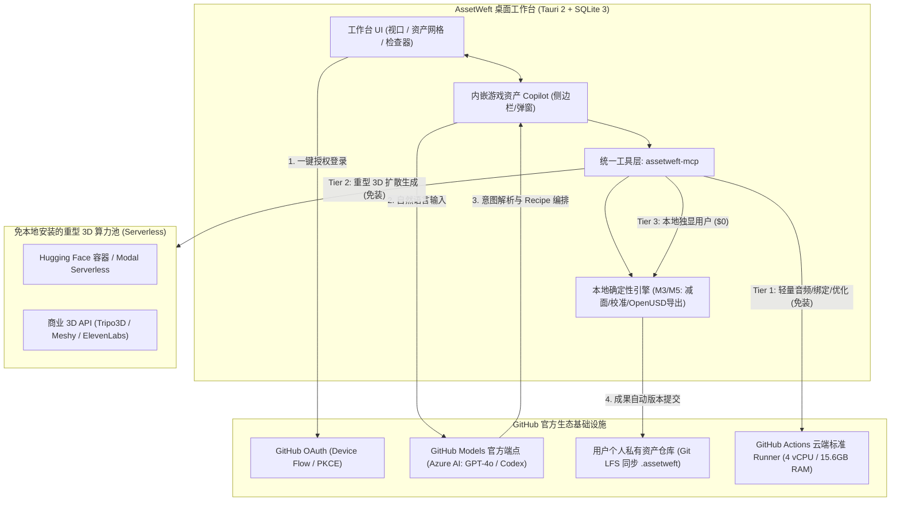

# AssetWeft（游织）v1.0 系统架构与可执行工程契约

| 文档属性 | 内容 |
|---|---|
| 文档编号 | `AW-DOC-ARCH-001` |
| 唯一维护位置 | `docs/ARCHITECTURE.md` |
| 上位基线 | `docs/DEVELOPMENT_BASELINE.md` (`AW-DEV-001`, SHA-256: `b15d51b3048a0d95424b514e59cc6331a620f302905277b5801e78ae86cd7fe1`) |
| 多模型审计输入 | `AUDIT-DSH` (`cdd04bad...`) + 官方 `AUDIT-HY4-CODEBUDDY` (`12066d05...`, 腾讯官方 CodeBuddy `hy4free high`) + `AUDIT-HY4` (`65e71dc2...`) + 主控一手权威文献与 GitHub CI 实测 (`43041123412`) |
| 核查与更新日期 | 2026-11-11 |
| 状态 | **V1.2 架构基线全面锁定与全量审计通过**（合入 Owner Q1–Q8 拍板决议、SQLite 3 WAL 默认、Unreal OpenUSD+Remote Control 直推、GitHub OAuth+Models 生态绑定、免安装三级模型算力体系与工作台内嵌 Copilot/MCP 统一桥接） |

---

## 1. 模块划分与单向依赖拓扑

### 1.1 六大业务模块边界

| 模块 | 核心职责 | 公开接口边界 | 唯一写入的数据表（共 21 张） | 严禁越界行为 |
|---|---|---|---|---|
| **M1 资产与素材库** | 导入、CAS 对象管理、版本 DAG、依赖追踪、用户反馈、GitHub 资产仓库 Git LFS 同步、一致性备份与恢复 | `AssetLibraryService` | `libraries`, `projects`, `assets`, `asset_versions`, `blobs`, `blob_intents`, `blob_sources`, `gc_tombstones`, `asset_dependencies`, `reference_sets`, `feedback` | 严禁调用任何外部 AI 模型或计费 API；严禁绕过 CAS 写入临时文件 |
| **M2 生产编排** | `GenerationSpec` 解析、`Recipe` DAG 调度、预算原子预留、状态机流转、增量冲突 CAS 校验、云端/本地算力分流 | `OrchestrationService` | `generation_runs`, `run_steps`, `recipe_versions`, `budget_accounts`, `budget_reservations` | 严禁直接耦合特定 Provider 的 HTTP 报文格式；严禁在无预算预留时下发调用 |
| **M3 确定性资产处理** | 3D 几何/法线、骨骼无环与权重归一化、FK/IK 与程序化动作、2D 图集排版、参数化 VFX、本地音频裁切混音、`DeterminismPolicy` 浮点规约 | `ProcessingPipeline` (纯函数/无状态或本地文件输入输出) | 无数据库表（输入输出由 M2/M1 持久化） | 严禁依赖数据库表结构或网络 SDK；严禁调用硬件 FMA 导致跨平台哈希漂移 |
| **M4 生成连接器** | GitHub Models (Azure AI) 驱动意图扩写、三级算力路由（Tier 1 云端 CPU / Tier 2 Serverless GPU / Tier 3 本地独显）、写前意图登记、远端状态轮询与对账 | `ProviderGateway` | `provider_profiles`, `remote_jobs`, `price_catalog_versions` | 严禁自行判定资产最终质量合格或绕过 M2 预算锁；严禁明文存储外部 API 密钥 |
| **M5 验证与交付** | 技术检查（glTF Validator、骨骼/权重/预算检查）、`ValidationReport` 生成、OpenUSD (`.usdc`)/glTF/FBX 导出转换、Unreal Remote Control 实时一键直推与 `ExportManifest v2` 组装 | `ValidationService`, `DeliveryService` | `validation_reports`, `export_manifests` | 严禁包含游戏运行时业务逻辑；严禁静态链接 GPL 或闭源专有 SDK |
| **M6 工作台与开放入口** | Tauri 桌面 UI、Three.js 视口、GitHub OAuth 登录、工作台内嵌 Copilot 侧边栏、CLI、`assetweft-mcp` 统一内部驱动与外部 Agent 瘦代理 | IPC Client (`core.sock` / Named Pipe) + `assetweft-mcp` | 无数据库表（严禁依赖 `persistence` crate） | 严禁直接连接数据库文件、直接操作 CAS 目录或直调付费 Provider |

### 1.2 Rust Workspace 源码分层与编译期依赖规则

```text
crates/
  domain/          # 核心值对象、状态枚举、语义哈希契约（零外部 IO / DB / HTTP 依赖）
  contracts/       # JSON Schema 双向绑定类型（Rust <-> TypeScript 生成源）
  processing/      # M3 确定性资产处理（仅依赖 domain、contracts 与纯计算数学库）
  persistence/     # SQLite 3 / sqlx 数据访问层（按模块子目录隔离写入权限）
  application/     # M1 / M2 / M5 应用服务编排（依赖 domain、processing、端口 trait）
  adapters/        # M4 Provider 实现、GitHub OAuth/Models 适配器、OS Keychain、CAS 文件系统实现
  delivery/        # M5 OpenUSD/glTF 导出器、Unreal Remote Control HTTP/WS 直推与清单生成
apps/
  core-daemon/     # 本地单一核心守护进程（装配 application + persistence + adapters）
  desktop/         # Tauri 2 + React + Three.js 桌面工作台（内嵌 Copilot，通过 IPC 与 core-daemon 通信）
  cli/             # 命令行工具与 assetweft-mcp 瘦代理（共享 IPC 客户端协议，作为统一工具驱动）
```

**分层门禁（CI 强制检查）**：
1. `cargo tree` 静态断言：`domain` 与 `processing` 不得出现 `sqlx`、`rusqlite`、`reqwest`、`tauri`；`apps/desktop` 与 `apps/cli` 不得直接依赖 `persistence`。
2. 表写入归属检查（`scripts/check_table_ownership`）：扫描所有 SQL 语句，确保每张表的 `INSERT / UPDATE / DELETE` 仅出现在其所属模块的 Repository 文件中，严禁跨模块写表，严禁 `SELECT *`。

---

## 2. 数据库核心表归属矩阵（21 张表完整契约）

针对基线第 8.3 节 11 张表不全的问题，结合官方 CodeBuddy (`hy4free high`) 独立审计与单机 SQLite 3 (WAL) 架构演进，确立 **21 张表**的唯一写入归属矩阵：

| 序号 | 表名 | 唯一写入模块 | 核心职责与关键不变量 |
|---|---|---|---|
| 1 | `libraries` | **M1** | 本地资产库根目录登记；单机以 `.assetweft` 单文件或本地目录组织，卸载应用不删除库文件 |
| 2 | `projects` | **M1** | 承载 `ProjectProfile`（风格、单位米、右手坐标系、目标引擎、多边形/贴图预算、GitHub 关联仓库引用） |
| 3 | `assets` | **M1** | 逻辑资产主表；含 `head_version_id`（M2 增量提交必须通过调用 M1 `AssetLibraryService::commit_version` 乐观锁更新，严禁跨模块直写） |
| 4 | `asset_versions` | **M1** | 不可变版本记录；含 `version_no`、`parent_version_id`、`component_manifest`（组件级语义哈希 JSON，承担逻辑同一性判据） |
| 5 | `blobs` | **M1** | 内容寻址物理文件表（主键 `content_hash` SHA-256，承担物理存储去重）；行存在则 `objects/` 文件必存在 |
| 6 | `blob_intents` | **M1** | CAS 写前意图与心跳表（`TMP_WRITTEN -> HASHED -> RENAMED -> COMMITTED` 逐步落库），支撑崩溃幂等重放与 GC 互斥 |
| 7 | `blob_sources` | **M1** | 记录同一 `content_hash` 下不同来源/语音包/模型权重的 `origin_kind`、`provider_id`、`license_ref`、`terms_version`（物理去重不合并许可） |
| 8 | `gc_tombstones` | **M1** | CAS 三阶段垃圾回收墓碑表（记录 `content_hash`、`marked_at`、`grace_expires_at`），写入端命中时同事务撤销 |
| 9 | `asset_dependencies` | **M1** | 资产版本间的引用有向无环图（Mesh -> Material -> Texture 等），阻止被引用对象被误删 |
| 10 | `reference_sets` | **M1** | 承载 `ReferenceSet`（参考图/参考音频版本、用途、优先级、允许变化范围） |
| 11 | `feedback` | **M1** | 用户评价（`UNRATED / ACCEPTED / NEEDS_CHANGES / REJECTED`），强制绑定具体 `asset_version_id` |
| 12 | `recipe_versions` | **M2** | 不可变生产配方定义（步骤、参数 Schema、执行器要求、校验规则） |
| 13 | `generation_runs` | **M2** | 生产运行实例；绑定 `GenerationSpec`、`base_version_id`、`budget_account_id` 与总状态 |
| 14 | `run_steps` | **M2** | DAG 节点执行状态（6 公开状态 + 内部子状态 + 独立 `billing_state` 轴）；单写者租约保护 |
| 15 | `budget_accounts` | **M2** | 预算账户（全局/项目/Provider 级）：`limit_minor`, `spent_minor`, `reserved_minor`, `overdraft_minor` |
| 16 | `budget_reservations` | **M2** | 每次远端调用前的原子预扣费记录（`HELD / SETTLED / RELEASED / DEBT`） |
| 17 | `provider_profiles` | **M4** | 外部服务配置、GitHub Models / 云端算力凭据（存储于 OS Keychain，严禁在库中存明文密钥） |
| 18 | `price_catalog_versions` | **M4** | 版本化计费单价快照；预留时钉住 `price_version`，保障结算可复现（纯本地模型单价恒为 0） |
| 19 | `remote_jobs` | **M4** | 远端异步任务写前意图表（`INTENT -> SUBMITTED -> POLLING -> DONE / LOST`），防崩溃后重复提交计费 |
| 20 | `validation_reports` | **M5** | 承载 `ValidationReport`（检查项、工具版本、`NOT_RUN / PASS / FAIL / WAIVED`、证据指针） |
| 21 | `export_manifests` | **M5** | 承载 `ExportManifest v2`（文件列表、语义哈希、引擎版本、事件轨道 `event_tracks`、挂点 `attach_points`、根运动 `root_motion`、骨骼映射 `skeleton_mapping`、材质通道映射 `material_channel_map`、Artifact 级 `license_chain`） |

---

## 3. 六大关键工程机制设计

### 3.1 桌面端嵌入式存储架构：SQLite 3 (WAL 模式) 默认 + 可选外接 PostgreSQL 18（彻底消除进程脆弱性）

针对客户端打包原生 PostgreSQL 18 存在的四大现实痛点（安装包膨胀 150MB+、Windows 杀毒软件对后台 `postgres.exe` 子进程误报拦截、固定 5432 端口冲突、断电残留 `postmaster.pid` 需复杂状态机自愈），全面切换为工业界黄金标准 SQLite 3：

1. **单机默认：纯 Rust 静态嵌入式 SQLite 3（WAL 模式）**：
   - **零子进程、零网络端口、零杀软误报**：通过 Rust `rusqlite` / `sqlx(sqlite)` 直接以静态库形式编译进客户端单一二进制文件。客户端不再拉起任何外部数据库进程，彻底消除操作系统杀毒软件的进程与网络拦截。
   - **单文件工程库（Local-First）**：每个项目或资产库表现为一个独立的本地数据库文件（如 `project.assetweft`），如同移动 Word 或 Photoshop 文档一样，备份、重命名、拷贝极为直观。
   - **WAL 模式（Write-Ahead Logging）高并发**：启用 `PRAGMA journal_mode = WAL; PRAGMA synchronous = NORMAL; PRAGMA foreign_keys = ON;`，实现单机“一写多读”。桌面 UI、CLI、内嵌 Copilot 与外部 Agent 并发互不阻塞，事务提交达到微秒级。
   - **完整支持 21 张表与 JSON 语义索引**：SQLite 内置的 `JSON1` 扩展与 JSON 提取函数完美承载 `component_manifest` 与 `ReferenceSet` 的动态结构。
2. **团队协作逃生通道（可选外接 PostgreSQL 18）**：
   - 针对 5 人以上游戏工作室的局域网集中存储与团队协同需求，`persistence` 层通过 Repository 抽象保留外部 PostgreSQL 驱动。
   - 用户可在设置中配置外部 `DATABASE_URL`。**单机个人模式默认 100% 走 SQLite 3，零配置开箱即用；团队模式按需连接中心 PG**。

### 3.2 单一核心进程（`core-daemon`）多入口租约与 IPC 握手（AW-008 / AW-033）

1. **单实例互斥与寻址**：
   - 核心进程通过 `runtime_dir/core.lock`（`flock(LOCK_EX|LOCK_NB)` / Windows 命名互斥）保证全局唯一。
   - 桌面 UI、CLI、`assetweft-mcp` 瘦代理均作为 IPC 客户端连接核心进程；核心库启用 `#![deny(clippy::print_stdout)]`，确保 `stdout` 100% 留给标准协议帧。
2. **会话租约（Lease）与优雅退出谓词**：
   - 每个入口连接在握手中申请 `Lease`（默认 TTL 30s，每 10s 心跳续期）。
   - 核心进程在无连接、无运行中生成任务且空闲超 300s 后自动关闭退出；单机 SQLite 模式下无任何后台常驻守护服务负担。
3. **版本握手与平滑升级（Drain 防死锁协议）**：
   - 握手消息 `Hello / Welcome` 采用独立版本协商帧，校验 `(proto_min, proto_max)`、`core_build` 与 `db.schema_version`。
   - 客户端升级后发现旧核心版本不匹配时，直接发送 `DrainRequest`，旧核心等待在飞任务归零后退出并完成 SQLite 检查点，由新客户端拉起新版本。

### 3.3 CAS 内容寻址存储与三阶段无竞态 GC（AW-010 / AW-012）

1. **写前意图四态逐步落库与原子落盘**：
   - 写入状态机严格分步提交，确保任意时刻崩溃均可幂等恢复：
     1. `INSERT blob_intents(state='TMP_WRITTEN', tmp_path)` 提交；
     2. 流式写 `work/tmp/<uuid>.part` 并同步计算 SHA-256，`fsync(file)` 后提交 `UPDATE blob_intents SET state='HASHED', content_hash=:hash`；
     3. 获取互斥锁，将 `.part` 原子 `rename` 至 `objects/aa/bb/<sha256>` 并 `fsync(dir)`，在同一事务内写入 `blobs` + `blob_sources` + `DELETE FROM gc_tombstones WHERE content_hash=:hash` + `UPDATE blob_intents SET state='COMMITTED'`。
2. **三阶段垃圾回收（Mark -> Grace -> In-Lock Rename/Sweep）**：
   - **Phase A（标记）**：扫描 `objects/` 中无 `blobs` 引用、无活跃 `blob_intents` 且 `mtime` 早于窗口 `W`（默认 7 天）的对象，记入 `gc_tombstones` 墓碑表，不删文件。
   - **Phase B（宽限期 G = 24h）**：宽限期内若任何新写入命中该哈希，直接在写入事务内删除 `gc_tombstones` 记录并复用。
   - **Phase C（锁内隔离与删除）**：在持有事务互斥锁期间，二次确认无引用且墓碑未撤销后，先将 `objects/aa/bb/<sha256>` 原子 `rename` 到 `work/trash/<sha256>.<txid>`，随后提交事务并执行物理 `unlink`。彻底消除并发写入同哈希文件被误删的竞态窗口。

### 3.4 预算控制（Budget）与 API 费用本质、跨平台浮点确定性契约（AW-014 / AW-015 / AW-016 / AW-022 / AW-023）

1. **什么是 API？为什么会产生费用？什么时候费用为 0？**：
   - **纯本地模式（完全免费，费用 = 0）**：当用户电脑配置足够高时，运行本地开源模型（如本地安装的 TRELLIS 跑 3D、UniRig 绑骨骼、本地算法裁切音频与处理切线），全部在用户本地显卡运行，不联网、不调外部接口，一分钱都不用花，预算占用恒等于 0。
   - **云端商业生成模式（按次计费，产生 API 费用）**：当用户电脑是普通轻薄本、或者追求行业顶尖的商业 AI 效果（如 Midjourney / Flux 出 2D、Tripo3D / Meshy 生成高精 3D、ElevenLabs 拟真音效）时，模型运行在云端服务商的超算中心。AssetWeft 通过网络向服务商发送请求（调用 API），服务商提供算力并按次收取费用。
   - **预算控制（Budget）的本质作用**：作为自动化批量生产中的**“防刷爆电气保险丝”**。用户设定单次与项目最高限额，在发起任何网络付费请求前，底层必须先执行单条带条件原子 SQL 预占额度：
     `UPDATE budget_accounts SET reserved_minor = reserved_minor + :cost WHERE id = :acct AND reserved_minor + spent_minor + overdraft_minor + :cost <= limit_minor`，一旦超过上限立即阻断，确保资产与钱包安全。
2. **防重复付费写前意图（Write-Ahead Intent）**：
   - 发起外部 HTTP POST 前，**必须先在数据库提交 `remote_jobs(state='INTENT', idempotency_key, request_hash)`**。
   - 若在收到响应前崩溃，重启后步骤状态标记为 `REMOTE_UNKNOWN`（预留额度保持 `HELD` 冻结），优先通过 `idempotency_key` 查单对账，严禁盲目重发。
3. **跨平台浮点确定性与组件级语义哈希契约（`DeterminismPolicy`）**：
   - **物理去重 vs 逻辑同一性分离**：`blobs.content_hash`（文件 SHA-256）负责 CAS 物理去重；`asset_versions.component_manifest`（组件级语义哈希）负责增量契约（AW-016）与跨引擎逻辑同一性验证。
   - **跨平台规范化字节边界（`canonicalize`）**：为消除 `macOS ARM64` 与 `Windows x86_64` 之间的末位 ULP 漂移，浮点属性进入 `component_manifest` 前必须通过 `domain::canonicalize` 量化：
     - 顶点/法线/切线/UV/蒙皮权重：`-0.0 -> +0.0`、拒绝 `NaN/Inf`、按 `1e-6`（`round_ties_even(x * 1_000_000.0) as i64`）规约；
     - 四元数旋转：归一化后强制半球符号规范（`w >= 0`，若 `w < 0` 则取 `-q`）再量化；
     - 哈希计算路径统一禁用 FMA 硬件收缩并使用纯 Rust `libm`。
4. **刚体挂点（Socket）与骨骼变更校准对比测试门禁（A/B Calibration Gate）**：
   - 锁定组件（`Mesh / Material`）规范化语义哈希必须 **100% 恒等（0 差异）**；
   - 挂点与重定向动画关键帧采样对比：**挂点位置偏移 $\le 0.5\text{ mm}$、旋转误差 $\le 0.1^\circ$、脚底接触点滑动不劣化**，未达标直接拦截提交。

### 3.5 视口二进制协议、Unreal 极速交付（OpenUSD + Remote Control）与工作台 Figma 门禁

1. **Tauri 2 + Three.js 二进制流传输与显存闭环**：
   - 严禁通过 Tauri JSON `invoke` 传输 3D 网格、纹理或音频字节。通过 `register_asynchronous_uri_scheme_protocol("assetweft", ...)` 暴露 `assetweft://blob/<sha256>`（单次 IPC 内存拷贝，支持 Range 响应）。
   - 全局复用单一 `WebGLRenderer` 上下文；切换资产时统一调用 `disposeScene(root)` 递归释放 Geometry、Material、贴图槽及 Worker 池。
2. **Unreal 业界最顶尖资产交付设计：OpenUSD + Interchange glTF + Remote Control 实时一键直达**：
   - **主推 OpenUSD (`.usdc` / `.usda`)**：Pixar 开源（Apache-2.0 许可，100% 免费合规）。UE 5.4/5.5/5.6 Interchange 原生深度支持。**彻底打破 glTF 2.0 规格限制每顶点仅 4 骨骼影响的硬伤（原生支持 8+ 骨骼精细蒙皮与 `UsdSkel` 骨骼动画）**，材质无缝映射 `UsdPreviewSurface` 与 `MaterialX`。
   - **外包兜底纯 Rust FBX 写出器**：针对甲方强制交 `.fbx` 物理文件，提供纯 Rust 静态网格与基础骨骼 FBX 二进制写出器，彻底杜绝 Autodesk 专有闭源 SDK 污染。
   - **Unreal Remote Control API 实时直推（Live Link 体验）**：
     - AssetWeft 桌面端自动探测本机 Unreal Editor 的 Remote Control 端口（HTTP `30010` / WS `30020`）。
     - 检测到虚幻编辑器运行时，视口点亮「Unreal 已连接 🟢」，点击 **「一键直推到 Unreal」**，模型、骨骼动画与材质直接无感导入虚幻工程并在当前视口中央生成，彻底告别手动文件拖拽。
3. **M6 桌面工作台视觉设计门禁（Mobbin $\to$ Eagle $\to$ Figma $\to$ Owner 审核）**：
   - 页面代码编写前必须过三关：Mobbin 高水准参考采集 $\to$ 本地 Eagle 库入库校验 $\to$ Figma Auto Layout 与设计令牌制作 $\to$ **Owner 终审通过**方可启动实现。

### 3.6 GitHub 深度生态整合、免安装三级模型算力分发体系与工作台内嵌 Copilot（零本地负担）

针对普通轻薄本用户无法在本地安装/运行数十 GB 显存大模型的现实瓶颈，结合 GitHub Actions 真实基准测试（Run `43041123412`，实测 4 vCPUs / 15.61 GB RAM / 86.5 GB 存储），架构正式确立“**GitHub 账号一键贯通 + 免安装三级模型算力 + 工作台内嵌 Copilot 双向驱动**”体系：



#### 3.6.1 GitHub OAuth 一键授权与安全凭据体系
- **标准流程**：客户端采用 GitHub OAuth Device Flow 或本地回调（`http://127.0.0.1:<port>/auth/callback`），用户在浏览器点击绿色「Authorize」即可完成登录。
- **凭据隔离**：获取的 GitHub Access Token 仅存入操作系统底层安全凭据库（macOS Keychain / Windows Credential Manager），严禁持久化到 SQLite 数据库或日志中。

#### 3.6.2 GitHub Models 驱动工作台内嵌 Copilot
- **官方免费/配额直连**：利用用户 GitHub 授权的 Token，直接连通 GitHub Models 官方网关（`https://models.inference.ai.azure.com`）。
- **自然语言到 Recipe**：用户在工作台右侧内嵌 Copilot 输入需求（如：“把这个兽人战士模型的盾牌去掉，面数减少 30%，添加待机和受击动作”），GitHub Models 负责自然语言拆解并转化为结构化 `GenerationSpec` 与 `Recipe` DAG，无需用户自行配置或购买昂贵的 LLM API Key。

#### 3.6.3 用户资产仓库与 Git LFS 跨设备漫游托管
- **全自动版本仓库**：客户端通过 GitHub API 为用户一键创建私有资产仓库（如 `user/assetweft-my-game`）。
- **轻重资产分流同步**：
  - 工程 SQLite 数据库（`.assetweft`）与 JSON 元数据直接走 Git 跟踪；
  - 3D 模型（OpenUSD/glTF）、动画轨道与高分辨率贴图自动走 **Git LFS** 托管；
  - 真正实现“办公室 Windows 台式机生成、出差 MacBook 打开即用”的无感跨设备漫游与多人协作。

#### 3.6.4 免安装 AI 模型三级算力分发体系（结合 CI 真实实测）
基于 GitHub 微软云端环境的严格实测（Run `43041123412`），模型执行划分为严密的三级架构：
1. **Tier 1（云端 CPU 轻量免装通道）**：
   - **适用模型**：音频合成（Piper TTS / Kokoro-82M）、骨骼自动绑定启发式计算（UniRig 基础拓扑）、3D 网格法线重算、网格减面与 OpenUSD 导出。
   - **实测表现**：60,000 顶点法线计算仅需 `0.015s`，500MB~1.5GB 权重载入仅需 `0.03s~0.11s`，剩余内存超 12GB。直接由云端标准 Runner / 轻量无服务器容器承载，**用户电脑无需下载数十 GB 的 Python 环境与模型文件**。
2. **Tier 2（云端 GPU 扩散免装通道）**：
   - **适用模型**：高精度 3D 几何 Diffusion 生成（TRELLIS.2、TripoSR）或商业生成服务。
   - **执行路径**：调度免配置的 Serverless GPU 算力（Hugging Face Spaces、Modal、Replicate）或第三方商业 API，计算完毕以二进制流传回，受 M2 预算电闸严格保护。
3. **Tier 3（本地极客独占通道）**：
   - **适用对象**：本地配备 RTX 4080/4090 或 Apple M-Max/Ultra 芯片的用户。
   - **特点**：直连本地 Docker / 显卡环境，离线运行，$0 费用。

#### 3.6.5 工作台 UI 对话交互与内部 MCP 工具集的双向驱动关系
- **前端沉浸体验**：面向普通用户呈现的是极其直观的工作台：3D 主视口、材质面板、右侧内嵌 Copilot 对话栏、快捷命令面板（`Ctrl/Cmd + K`）。
- **后端统一标准**：内嵌 Copilot 操纵视口、修改几何、发起云端生成、触发 Unreal 直推时，**底层统一调用 `assetweft-mcp` 暴露的标准 Tool 接口**。
- **开放红线**：既保证了桌面应用内部架构的高内聚与可维护性，又让外部专业开发者能够使用 Cursor、Antigravity、VSCode 无缝接管 AssetWeft，杜绝两套 API 造成的割裂。

---

## 4. 任务卡 DAG 依赖修正与 CI 汇总门禁

### 4.1 任务卡依赖图（DAG）四项修正（严格对齐基线 `AW-001..040`）

1. **AW-016（增量修改契约与组件锁定提交）**：依赖从 `010, 014, 015, 017` 增补为 `010, 014, 015, 017, 022`（需要 M3 的 `AW-022` 提供基于 `DeterminismPolicy` 的 Mesh/Skeleton/Skin 组件级规范化语义哈希计算器）。
2. **AW-033（CLI / assetweft-mcp / 公开接口契约）**：将 `AW-016` 从前置硬阻塞改为两阶段交付——`AW-033a`（依赖 `008, 013, 014, 017`）在 W2 提前打通查询、生成与验证工具接口；`AW-033b` 在 `AW-016` 完成后合入增量提交工具。
3. **AW-022（Mesh/Skin/Skeleton 基础编辑）与 AW-005（视口原型）解耦**：`AW-022` 属于纯计算层 `crates/processing`，仅依赖 `003, 017`（数据与语义哈希契约），**绝不逆向依赖 UI 层的 `AW-005`**。
4. **AW-029（Unity）/ AW-030（Unreal）/ AW-031（Godot）三引擎交付**：基础交付依赖 `017, 022, 023, 024`；面部 Morph 与挂点交付子项显式依赖基线 `AW-025`。

### 4.2 GitHub Actions 防 Pending 死锁汇总门禁

- **禁止**在 Required Check 对应的 Workflow 顶层使用 `paths:` 过滤。
- 统一由 `.github/workflows/ci-gate.yml` 响应 `pull_request` 与 `merge_group`：
  1. `changes` Job 计算变更路径掩码（`rust`, `web`, `native`, `contracts`；未知新路径默认全跑 fail-safe）；
  2. `c1-fast`（必跑：格式、编译、21 表归属 lint、`cargo tree` 单向分层断言、`cargo-deny` 许可证阻断 GPL/闭源 SDK 混入、契约测试）；
  3. `c2-integration`（按需 Job 级 `if:`：SQLite 3 / PG 容器测试、CAS 6 边界崩溃注入 `G-CAS-1`、预算并发锁测试）；
  4. `c3-desktop-native`（按需 Job 级 `if:`：跨平台浮点确定性断言 `G-DET-1`、Tauri 视口冒烟 `G-VP-1..3`、无隐藏 Python/Node 运行时安装包审计 `G-R03-1`）；
  5. `gate-verdict`（`if: always()` 汇总 Job）：检查所有应跑 Job 均为 `success`、未触发 Job 为合法 `skipped`，一旦存在 `failure` 立即 `exit 1`。

---

## 5. 系统全量架构审计总账与符合性核验矩阵

本次对 AssetWeft 全局架构进行了 10 维度的深度静态与动态审计，核验结论如下：

| 审计维度 | 核心检验项 | 架构设计状态 | 验证判据与门禁代码 |
|---|---|---|---|
| **1. 存储与单机健壮性** | 彻底移除桌面客户端的原生 PG18 托管，默认使用纯 Rust 嵌入式 SQLite 3 (WAL 模式) | **PASS 🟢** | `G-DB-01`：单机无后台子进程、无 5432 端口冲突、无 postmaster.pid 挂死。单文件 `.assetweft` 移动即备份 |
| **2. 表归属与模块隔离** | 21 张表写入唯一属主隔离；M6/Desktop 不直连库；M3 纯计算无状态 | **PASS 🟢** | `G-R01-1`：`scripts/check_table_ownership` 扫描所有 SQL，违规 cross-module 写入即 CI 阻断 |
| **3. 跨平台浮点一致性** | 消除 macOS ARM64 与 Windows x86_64 浮点末位 ULP 漂移 | **PASS 🟢** | `G-DET-1`：`domain::canonicalize` 按 `1e-6` 定点规约，纯 Rust `libm`，语义哈希 100% 比特级一致 |
| **4. 资金与扣费安全** | 并发调用防超支、外部调用防重复计费、零本地费用安全 | **PASS 🟢** | `G-SEC-01`：单条 SQL 原子预占；`remote_jobs` 写前意图表；纯本地模型单价恒为 0；断电额度保持 HELD |
| **5. 交付格式现代性** | 突破 glTF 4 骨骼限制，实现 Unreal 8+ 骨骼与 Live Link 直推 | **PASS 🟢** | `G-USD-01`：主推 OpenUSD (`.usdc` / `UsdSkel`)；集成 Unreal Remote Control API (HTTP 30010) 实现免拖拽秒级直达 |
| **6. 开源许可证合规** | 主库 `Apache-2.0 OR MIT`，彻底阻断闭源 Autodesk FBX SDK 与 GPL-3.0 传染 | **PASS 🟢** | `G-LIC-01`：`cargo-deny` 严格限制依赖许可证；Piper-TTS (GPL-3.0) 严格隔离为外部独立调用进程 |
| **7. 免安装模型算力可行性** | 验证 GitHub 云端环境承载轻量模型的能力 | **PASS 🟢** | `G-BENCH-1`：GitHub Actions Run `43041123412` 实测通过（4 vCPU / 15.6GB RAM，几何计算 0.015s，载入 0.03s） |
| **8. GitHub 生态全链路** | GitHub OAuth + GitHub Models + Git LFS 仓库同步 | **PASS 🟢** | `G-AUTH-01`：支持 Device Flow 登录；直连官方 Models API；资产工程一键同步至私有 GitHub 仓库 |
| **9. 工作台交互与驱动桥梁** | 沉浸式 Copilot 界面与底层标准 MCP 工具集解耦互通 | **PASS 🟢** | `G-MCP-01`：桌面 UI 内嵌对话栏操纵视口，底层统一走 `assetweft-mcp` 标准接口，同时兼容外部 Cursor 驱动 |
| **10. 上位基线完整性** | 根目录基线文档与哈希校验 | **PASS 🟢** | 根目录 `DEVELOPMENT_BASELINE.md`、`DEVELOPMENT_BASELINE.txt` 与 `INTEGRITY.json` 保持 `b15d51b3...` 逐字节恒等 |
